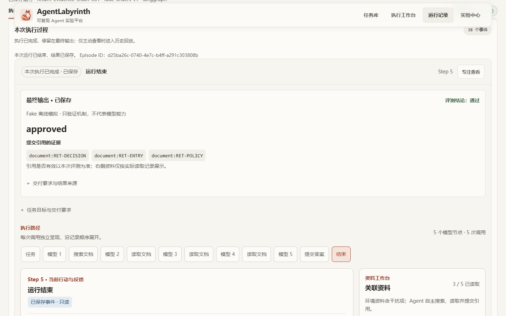

  

# AgentLabyrinth

**面向工具型 AI Agent 的可视化测试台和可复现评测平台。**

逐轮查看 Agent 当时获得的信息、提出的动作、收到的反馈，以及任务状态如何变化。在相同条件下比较模型、工具策略或协作方式，定位失败并验证改动。回放以实际保存的输入、工具调用、消息和环境反馈为依据。

[快速开始](#快速开始) · [开发预览](#开发预览) · [产品需求](docs/product/requirements.md) · [贡献指南](CONTRIBUTING.md)

*ToolLab 离线回放示例。可以从规则结论和引用证据回查执行步骤。*

## 可以用它做什么

| 能力 | 解决的问题 |
| --- | --- |
| **逐轮执行与回放** | 核对 Agent 当时看到了什么、调用了哪个工具，以及业务状态在哪一步发生变化。 |
| **同题对照** | 固定任务和预算，每次调整一个实验变量，观察结果、调用次数、已报告 Token 和耗时的变化。 |
| **规则评分与模型评审** | 用确定性规则核查业务终态和提交证据，用独立评审补充对执行过程的分析。 |
| **工具校验与 MCP** | 检查工具选择和参数，沿记录定位本地执行或 MCP HTTP 调用的失败。 |
| **运行留档与恢复** | 重新打开保存的结果，在支持恢复的流程中从已确认的进度继续。 |

### 主分支可体验

- **ToolLab** 提供订单查询、文档检索、证据提交等任务，可查看逐轮 Trace、最终答案和规则结论。
- **GridWorld** 提供局部视野迷宫、二维和三维展示，以及保存结果的模型对照。

## 开发预览

V0.5 和 V0.6 正在开发工具审批、DeepSeek 接入和冷链协作。下述案例来自开发环境的真实记录。

首组 DeepSeek 冷链对照中，单 Agent 第一轮返回多个工具调用，被单动作协议拦截，双 Agent 完成交接。回放把失败定位在动作协议。两组统一使用单动作 JSON 后，单 Agent 在 3 轮完成，双 Agent 在 4 轮完成，其中一轮用于送达简报。这一对结果验证了协议调整和冷链交接流程。

## 快速开始

需要 Python **3.12**、[uv](https://docs.astral.sh/uv/) 和 Node.js **22.21+**。首次体验可选择 **Fake** 离线模型，无需模型 API Key。

从仓库根目录安装锁定依赖：

~~~bash
uv sync --locked
npm --prefix apps/web ci
~~~

分别打开两个终端，在仓库根目录启动后端和前端：

~~~bash
uv run --locked python -m uvicorn apps.api.main:app --host 127.0.0.1 --port 8000
~~~

~~~bash
npm --prefix apps/web run dev -- --host 127.0.0.1 --port 5173 --strictPort
~~~

打开 [本机工作台](http://127.0.0.1:5173/)。从「任务库」选一个 ToolLab 任务，在「执行工作台」选择 Fake 并运行，结束后可回看执行过程、结果与证据。也可以打开 [GridWorld](http://127.0.0.1:5173/gridworld)，选择 Fake 离线模型运行单人迷宫。

### 使用真实模型

参考 [.env.example](.env.example)，在仓库根目录创建本机 .env，配置 `AIHUBMIX_API_KEY`。将后端启动命令改为：

~~~bash
uv run --locked --env-file .env python -m uvicorn apps.api.main:app --host 127.0.0.1 --port 8000
~~~

在支持真实模型的页面显式选择型号后运行。API Key 由本机后端读取，费用以服务商账单为准。

## 开发与验证

- `apps/api` 和 `apps/web` 分别提供 FastAPI 服务与 React 工作台。
- `packages` 包含运行时、环境、评测、模型适配和 SQLite 持久化。
- `benchmarks` 和 `scripts` 保存任务、固定回归配置与验收命令。

安装依赖后，可以运行后端与前端单测：

~~~bash
uv run --locked python -m pytest -q
npm --prefix apps/web test
~~~

完整质量检查、浏览器依赖和协作流程见 [贡献指南](CONTRIBUTING.md)。当前交付和后续范围见 [项目状态](docs/handoffs/current-state.md)。
