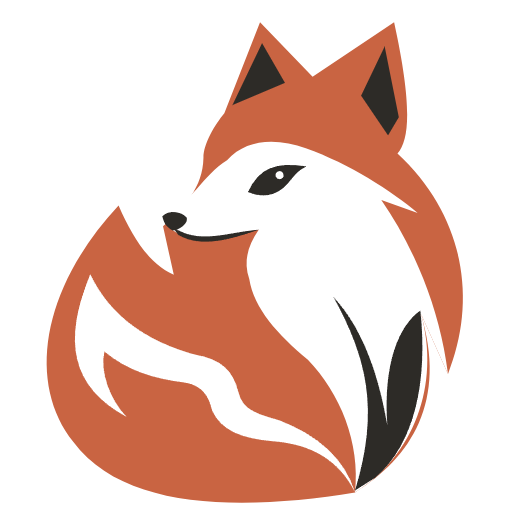

  

<h1 align="center">AgentLabyrinth</h1>

<strong>运行、回放和比较工具型 AI Agent</strong>

  <a href="#快速开始">快速开始</a> ·
  <a href="#功能">功能</a> ·
  <a href="#文档与贡献">文档与贡献</a>

AgentLabyrinth 是一个在本机运行的 Agent 测试台。逐步查看 Agent 读到了哪些资料、调用了什么工具，以及环境如何响应。用同一道任务比较模型或运行配置，核对一次改动是否改善了结果。

## 快速开始

需要 **Python 3.12**、[uv](https://docs.astral.sh/uv/) 和 **Node.js 22.21+**。第一次运行使用 Fake 模型，无需 API Key。

~~~bash
git clone https://github.com/fate222miracle/AgentLabyrinth.git
cd AgentLabyrinth
uv sync --locked
npm --prefix apps/web ci
~~~

在仓库根目录开两个终端，分别启动 API 和 Web。

~~~bash
uv run --locked python -m uvicorn apps.api.main:app --host 127.0.0.1 --port 8000
~~~

~~~bash
npm --prefix apps/web run dev -- --host 127.0.0.1 --port 5173 --strictPort
~~~

打开 [本机工作台](http://127.0.0.1:5173/)，从「任务库」挑一道 ToolLab 任务，在「执行工作台」选择 **Fake** 并开始运行。完成后点击执行路径中的任一步，检查当轮的工具调用和反馈，再回看提交的答案及证据。

也可以进入 [GridWorld](http://127.0.0.1:5173/gridworld)，回放 Agent 在局部视野下拾取钥匙、开门并走到目标的过程。

配置真实模型

参考 [.env.example](.env.example) 在仓库根目录创建本机的 .env 文件，配置 `AIHUBMIX_API_KEY`。使用以下命令启动 API，再在页面选择可用型号。

~~~bash
uv run --locked --env-file .env python -m uvicorn apps.api.main:app --host 127.0.0.1 --port 8000
~~~

## 功能

- **复盘执行。** 在 ToolLab 中追踪订单查询、文档阅读与证据提交，核对工具参数、环境反馈和规则评分。
- **比较结果。** 在同一任务上对照模型或运行配置，查看任务结果、已报告的 Token 和耗时。
- **观察环境。** 用二维或三维 GridWorld 回放迷宫动作。支持 MCP 的任务还可沿 Trace 查看工具调用与返回。
- **回查历史。** 重新打开保存的运行，在支持恢复的流程中从已确认的进度继续。

## 文档与贡献

- [需求与路线图](docs/product/requirements.md)
- [贡献指南与质量检查](CONTRIBUTING.md)
- [反馈问题](https://github.com/fate222miracle/AgentLabyrinth/issues)

**开发预览** · 工具审批、DeepSeek 接入和多 Agent 冷链协作属于后续开发版本。进度见 [项目记录](docs/handoffs/current-state.md)。
