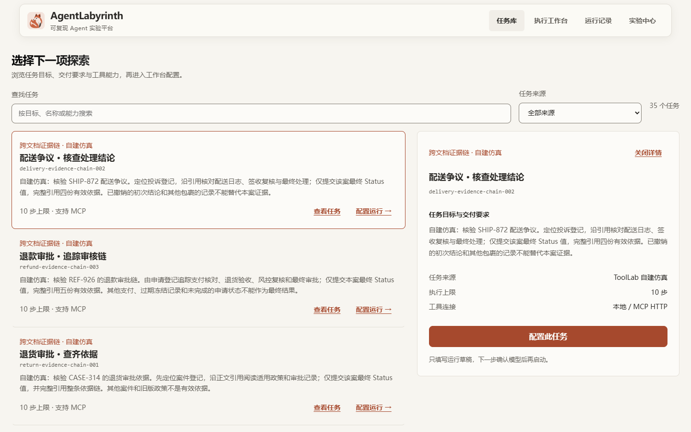
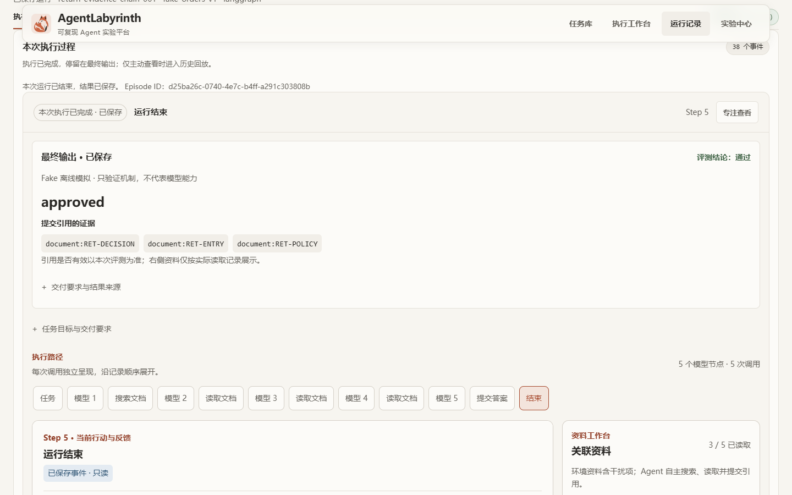

# 工作区与最终交付截图

用于UI审查的离线截图，不含密钥、用户数据或真实模型回复。2026-11-02系统Edge回归生成，2026-11-03随负责人明确要求的GitHub交付纳入设计说明；原完整实验/测试产物仍留在忽略目录。

任务库使用公开自建模拟任务：

最终交付使用Fake运行，仅证明展示机制，不代表模型质量：

实际源码与历史/实时边界见[主线交接](../../learning/ui-demo-mainline-20261102.md)；最新门禁见[current-state](../../handoffs/current-state.md)，本图不是2026-11-03重新截图或真实模型效果证据。
